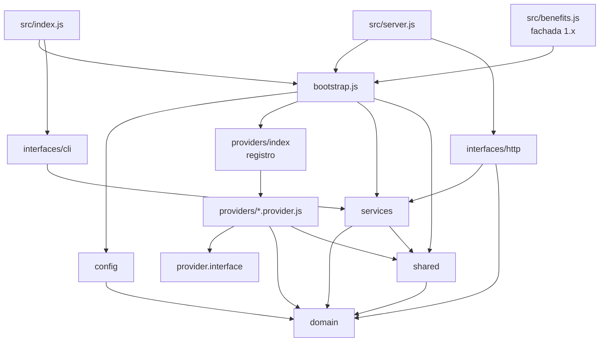

# Arquitectura

Buscador de beneficios de bancos, tarjetas y billeteras de Chile. Consulta en vivo las fuentes públicas de 7 emisores, normaliza cada beneficio a un `Entry` común y filtra por palabra clave. Se usa por CLI y por API HTTP. La API está pensada para una app móvil Android/iOS.

- Node 18 o superior, CommonJS y **cero dependencias de runtime** (solo módulos nativos).
- Contrato HTTP: [`openapi.yaml`](openapi.yaml). Agregar un emisor: [`AGREGAR_EMISOR.md`](AGREGAR_EMISOR.md).
- Qué cambió respecto de la 1.x: [`CHANGELOG_REFACTOR.md`](CHANGELOG_REFACTOR.md). Riesgos y deuda: [`RIESGOS.md`](RIESGOS.md).

## Capas

```
src/
├── config/        Lee .env y entrega la configuración validada (sin efectos al importar)
├── domain/        Entry (factory, validación, id estable) y errores con código estable
├── shared/        Utilidades sin negocio: texto, fechas, async, cliente HTTP, logger, caché
├── providers/     Un módulo por emisor + contrato común + registro
├── services/      Orquestación de la búsqueda, matcher, runner (caché/timeout) y estado por emisor
├── interfaces/
│   ├── cli/       Formateo de texto y ejecución del CLI
│   └── http/      Servidor, router, controllers, middlewares, validación y serializers
├── bootstrap.js   Composition root: único lugar que arma las dependencias concretas
├── index.js       Entrypoint del CLI
├── server.js      Entrypoint de la API
└── benefits.js    Fachada de compatibilidad con la API pública 1.x
```



**Regla de dependencias.** Las flechas apuntan hacia `domain`. `services` no conoce emisores concretos: recibe el registro. Los providers no conocen servicios ni interfaces. `npm run lint` verifica estas reglas automáticamente (ver [Calidad](#calidad)).

| Capa | No puede importar |
|---|---|
| `domain` | ninguna otra capa |
| `shared`, `config` | `providers`, `services`, `interfaces` |
| `providers` | `services`, `interfaces`, `config` (la configuración llega por `ctx`) |
| `services` | `providers` (los recibe por el registro), `interfaces`, `config` |

## Flujo de una búsqueda

```
GET /v1/search?q=rappi
  └─ server.js ─ router (ruta exacta) ─ search.controller
       ├─ validation.parseV1Search          q, banks (key o nombre), page, pageSize
       ├─ searchService.search(query, { banks, allowKeys })
       │    ├─ registry.select(banks)        emisores incluidos, en orden fijo
       │    ├─ runner.run(provider) × N      en paralelo; NUNCA rechaza
       │    │    ├─ cache.get("provider:<key>")      hit → devuelve sin red
       │    │    ├─ in-flight dedupe                 N peticiones = 1 descarga
       │    │    ├─ provider.fetch(ctx) con timeout por emisor
       │    │    ├─ cache.set(...) solo si tuvo éxito
       │    │    └─ SourceReport { status: ok|empty|error, count, cached, durationMs, error? }
       │    └─ matcher.matchesQuery(entry, query)
       └─ serializers.toV1SearchResponse     paginación, payload liviano, nulls
```

## Decisiones (qué y por qué)

| Decisión | Por qué |
|---|---|
| **Composition root único** (`bootstrap.js`) | Las interfaces y los tests piden una "app" armada. Así se inyectan `fetch`, reloj, `sleep`, caché y providers sin tocar el código de negocio. |
| **Contrato de provider** `{ key, name, queryDependent, fetch(ctx) }` | El servicio depende del contrato, no de los emisores. Agregar uno es crear un archivo y sumar una línea al registro. |
| **`ctx` en vez de globales** (`http`, `config`, `now`, `sleep`, `signal`) | Los providers se prueban sin red ni reloj real, y el timeout cancela las pausas y peticiones en curso. |
| **Parsing en funciones puras exportadas** (`parseCopec`, `parseBancoChileEntry`…) | Se prueban con un objeto, sin simular HTTP. |
| **`Entry` inmutable y con `id` estable** (`<emisor>-<sha1(id de la fuente)>`) | La caché comparte objetos entre peticiones, y la app móvil necesita una clave para listas y favoritos. |
| **Errores con `code` estable** (`domain/errors.js`) | La app decide por `code`; el `message` es solo diagnóstico. |
| **Dos formatos de API**: legado (`/search`, `/health`) y `/v1` | La 1.x no se rompe, y `/v1` puede tener un contrato pensado para móvil (paginación, nulls, errores uniformes). |
| **`CacheStore` asíncrono** con implementación en memoria | Se puede reemplazar por Redis cuando haya más de una instancia, sin tocar los servicios. |
| **El CLI y la fachada no usan caché ni timeouts** | Conservan exactamente la semántica 1.x: un proceso nuevo por consulta, que espera a todos los emisores. |
| **CommonJS** (no ESM) | No hay beneficio concreto que justifique migrar, y la fachada debe seguir siendo `require`-able por consumidores 1.x. |
| **Sin dependencias** | Lo pide el proyecto. El router, el body parser, CORS y el logger son pequeños y están probados. |

## Preparación para la app móvil

| Tema | Implementación |
|---|---|
| Versionado | `/v1/search`, `/v1/banks`, `/v1/health`. Las rutas sin versión siguen funcionando (deprecadas). |
| Contrato | [`openapi.yaml`](openapi.yaml), con un test (`tests/interfaces/openapi-sync.test.js`) que falla si una ruta o un campo no está documentado. |
| Errores | `{ error: { code, message, details? } }` con el status HTTP correcto (400, 404, 405, 413 y 500). Los 500 no exponen detalles internos. |
| Ruteo | Coincidencia exacta de método y ruta. En `/v1`, un método no permitido responde 405 con el header `Allow`. |
| Validación | `q` de 1 a 100 caracteres; hasta 20 `banks`, por key o nombre (si hay desconocidos, responde 400 `UNKNOWN_BANK` con la lista válida); `page` ≥ 1; `pageSize` entre 1 y 100. |
| Payload | `Benefit` con `id`, `bank`, `bankKey`, `title`, `subtitle`, `description` (hasta 300 caracteres), `commerceName`, `category`, `validFrom`, `validUntil`, `url` y `logo`. Los campos vacíos van como `null`. No se envían los campos internos de búsqueda. |
| Paginación | `page` y `pageSize`; la respuesta trae `pagination { page, pageSize, total, totalPages, hasMore }`. |
| Caché | En memoria, con TTL por emisor (`CACHE_TTL_SECONDS`, por defecto 1800). Las búsquedas siguientes pasan de unos 12-20 s a milisegundos. `CACHE_WARMUP=true` precarga los catálogos al iniciar. |
| Resiliencia | Timeout por petición (`HTTP_TIMEOUT_MS`) y por emisor (`PROVIDER_TIMEOUT_MS`). Si un emisor falla, la respuesta es parcial (`meta.partial`, `errors`, `sources`). Un catálogo con 0 registros queda como `empty` y genera una alerta `provider_empty` en el log. |
| Observabilidad | Logger JSON por línea en stderr (`LOG_LEVEL`), con `x-request-id` por petición y log de acceso. `/v1/health` muestra el estado de cada emisor; `?probe=true` los consulta en el momento. |
| CORS | `CORS_ORIGINS` (lista o `*`). Vacío = desactivado, porque las apps nativas no lo necesitan. |

### Recomendaciones para producción (no implementadas)

- **Autenticación.** Exigir API key por header `x-api-key` en `/v1/*`, con llaves en `.env` o en un gestor de secretos y rotables. CORS ya permite ese header. Si la API se expone a usuarios finales, conviene un gateway (por ejemplo Cloudflare o API Gateway) que la valide.
- **Rate limiting.** Limitar por API key o IP (por ejemplo 60 peticiones por minuto) antes de llegar a Node, en el gateway o el proxy. Las búsquedas son baratas mientras la caché está vigente, pero una caché fría dispara unas 25 peticiones a fuentes externas.
- **Varias instancias.** Reemplazar `MemoryCacheStore` por un `CacheStore` compartido (Redis) y activar `CACHE_WARMUP` en una sola instancia o en un job programado.
- **Stale-while-revalidate.** Al vencer la caché, servir el dato anterior mientras se renueva en segundo plano, para que ningún usuario espere 15 s.
- **Métricas.** Exportar `durationMs` y `status` por emisor (los logs `provider_*` ya los traen) a un sistema de alertas.

## Pruebas

| Tipo | Dónde | Qué asegura |
|---|---|---|
| Caracterización | `tests/characterization/` | La salida de la fachada, el CLI y la API legada coincide byte a byte con el golden (`tests/fixtures/golden/`). |
| Equivalencia con 1.x | `original-equivalence.test.js` | Fuera de los cambios intencionales, todo es idéntico a lo que producía el código original (`tests/fixtures/golden-original/`, commit `f8352c7`). |
| Aceptación | `tests/acceptance/` | Los casos de negocio por emisor (PROWASHGO, temu, pedidos ya, burger king, Rappi, El Café Rosa) funcionan por servicio, CLI y API. |
| Unitarias | `tests/unit/` | Parsers, http-client, config, caché, runner, router, validación y serializers. |
| Contrato | `tests/interfaces/` | API v1 completa y sincronía con `openapi.yaml`. |
| En vivo | `npm run smoke` | Los casos de aceptación contra los sitios reales (requiere internet y `.env`). |

- **Sin internet.** Los fixtures en `tests/fixtures/http/` son respuestas reales grabadas. Para los procesos hijo (CLI y servidor), `preload.js` reemplaza `fetch`, congela la fecha en 2026-11-12 y acelera las pausas.
- **Actualizar fixtures:** `npm run fixtures:record -- <emisor>`, luego `npm run fixtures:golden`, y revisar el diff en git.

## Calidad

`npm run lint` no tiene dependencias. Revisa la sintaxis de todos los archivos y estas reglas de arquitectura:
- máximo 200 líneas por módulo;
- `process.env` solo en `src/config/`;
- `fetch` global solo en `src/shared/http-client.js`;
- ninguna llave de 32 caracteres hexadecimales en `src/` ni en `docs/`;
- las dependencias entre capas de la tabla anterior.

`npm run check` corre el lint y los tests.

**Propuesta pendiente de aprobación:** agregar como devDependencies `eslint` (con `eslint-config-prettier`) y `prettier`, configurado con `singleQuote`, `semi`, `trailingComma: all` y `printWidth: 100`. Así el estilo se aplica automáticamente en lugar de mantenerlo a mano. No se instalaron porque requieren aprobación.
