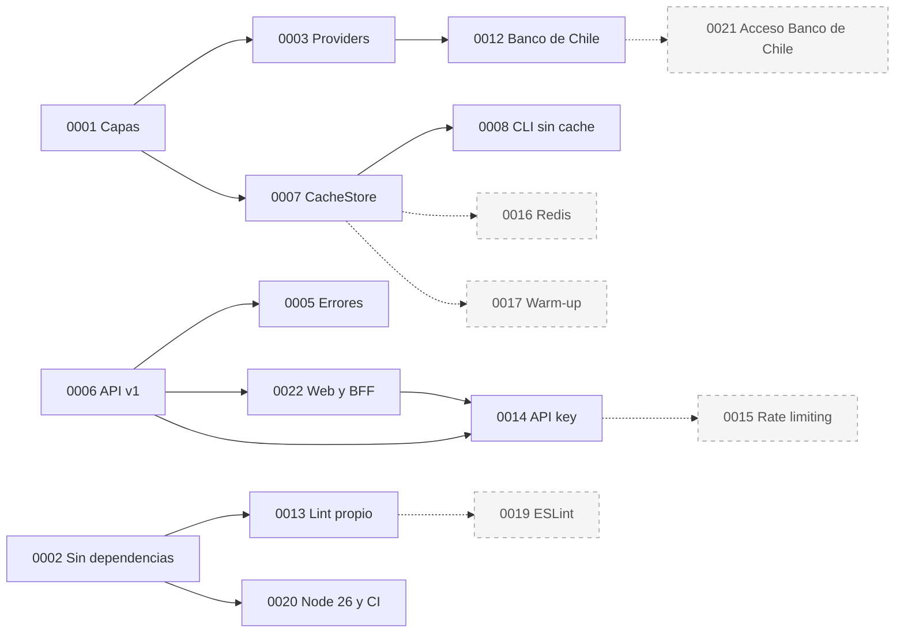

# Registro de decisiones de arquitectura (ADR)

Cada ADR documenta **una** decisión: el contexto, las alternativas, lo que se decidió y sus consecuencias. Formato [MADR](https://adr.github.io/madr/), numeración correlativa y un archivo por decisión.

- **Aceptado:** ya está en el código. El 0014, el 0018, el 0020 y el 0022 se aceptaron al implementarse. Los ADR 0001 a 0013 son **retroactivos**: se redactaron después de implementar, a partir del código, el historial de git y `docs/CHANGELOG_REFACTOR.md`. Las alternativas descartadas salen de lo que se evaluó durante el trabajo. Las marcadas como *(reconstruida)* son alternativas razonables que no hay registro de que se evaluaran en su momento: se agregaron para que el ADR explique por qué la decisión tomada es mejor.
- **Propuesto:** todavía **no** está decidido ni implementado. Necesita aprobación antes de aplicarse.
- **Reemplazado:** sustituido por otro ADR, que se enlaza. Hoy no hay ninguno.

## Índice

| # | Decisión | Estado | Fecha |
|---|---|---|---|
| [0001](0001-arquitectura-por-capas-con-composition-root.md) | Arquitectura por capas con composition root | Aceptado | 2026-11-12 |
| [0002](0002-node-nativo-sin-dependencias-y-commonjs.md) | Node nativo, sin dependencias de runtime y en CommonJS | Aceptado | 2026-11-12 |
| [0003](0003-contrato-de-provider-y-registro.md) | Contrato de provider y registro de emisores | Aceptado | 2026-11-12 |
| [0004](0004-entry-inmutable-con-id-estable.md) | `Entry` validado, inmutable y con `id` estable | Aceptado | 2026-11-12 |
| [0005](0005-errores-con-codigo-estable.md) | Errores con código estable y respuestas parciales | Aceptado | 2026-11-12 |
| [0006](0006-api-versionada-v1-con-rutas-legadas.md) | API versionada `/v1`, conservando las rutas 1.x | Aceptado | 2026-11-12 |
| [0007](0007-cache-en-memoria-detras-de-cachestore.md) | Caché en memoria por emisor detrás de `CacheStore` | Aceptado | 2026-11-12 |
| [0008](0008-cli-y-fachada-sin-cache-ni-timeouts.md) | CLI y fachada sin caché ni timeouts | Aceptado | 2026-11-12 |
| [0009](0009-tests-de-caracterizacion-con-fixtures-y-golden.md) | Tests de caracterización con fixtures reales y golden | Aceptado | 2026-11-12 |
| [0010](0010-secretos-en-env-via-config-validada.md) | Secretos solo en `.env`, leídos por una config validada | Aceptado | 2026-11-12 |
| [0011](0011-copec-pay-via-endpoint-rest-del-tema.md) | Copec Pay a través del endpoint REST del tema WordPress | Aceptado | 2026-11-12 |
| [0012](0012-banco-de-chile-via-api-modyo-y-jina.md) | Banco de Chile a través de la API de contenido Modyo y `r.jina.ai` | Aceptado | 2026-11-12 |
| [0013](0013-reglas-de-arquitectura-con-lint-propio.md) | Reglas de arquitectura verificadas con un lint propio | Aceptado | 2026-11-12 |
| [0014](0014-autenticacion-con-api-key.md) | Autenticación de la API con API key | Aceptado | 2026-11-13 |
| [0015](0015-rate-limiting.md) | Rate limiting | **Propuesto** | 2026-11-12 |
| [0016](0016-cachestore-compartido-en-redis.md) | `CacheStore` compartido en Redis | **Propuesto** | 2026-11-12 |
| [0017](0017-warm-up-programado-y-stale-while-revalidate.md) | Warm-up programado y stale-while-revalidate | **Propuesto** | 2026-11-12 |
| [0018](0018-futuro-de-mercado-pago.md) | Futuro de Mercado Pago como emisor | Aceptado | 2026-11-12 |
| [0019](0019-eslint-y-prettier.md) | ESLint y Prettier como devDependencies | **Propuesto** | 2026-11-12 |
| [0020](0020-actualizacion-a-node-26-y-ci.md) | Actualización a Node 26 (LTS) e integración continua | Aceptado | 2026-11-12 |
| [0021](0021-acceso-a-banco-de-chile-sin-proxy-gratuito.md) | Acceso a Banco de Chile sin depender de un proxy gratuito | **Propuesto** | 2026-11-12 |
| [0022](0022-web-nextjs-con-bff.md) | Web en Next.js con Route Handlers como BFF | Aceptado | 2026-11-12 |



**Leyenda del grafo**
- **Flecha continua:** un ADR aceptado se apoya en otro.
- **Flecha punteada hacia una caja gris:** ADR propuesto que extiende o revisa uno aceptado.
- 0004, 0009, 0010, 0011 y 0018 no aparecen porque no dependen de otros ADR.
- 0020 reemplaza solo la versión mínima de Node de 0002.

## Cómo agregar un ADR

1. Copia la plantilla en `docs/adr/NNNN-titulo-corto.md`, con el número siguiente y el título en minúsculas, sin tildes y con guiones.
2. Crea el ADR en estado **Propuesto** y abre un PR. Pasa a **Aceptado** cuando el PR se aprueba y la decisión se implementa.
3. Nunca edites la decisión de un ADR aceptado: crea uno nuevo y marca el anterior como **Reemplazado por NNNN**.
4. Agrégalo a la tabla de este índice.

### Plantilla

```markdown
# NNNN. Titulo de la decision

- **Estado:** Propuesto | Aceptado | Reemplazado por [NNNN](NNNN-titulo.md)
- **Fecha:** AAAA-MM-DD
- **Relacion:** extiende / depende de / reemplaza a [NNNN](NNNN-titulo.md)

## Contexto

Que problema hay, que restricciones aplican y por que hay que decidir ahora.

## Alternativas consideradas

1. **Opcion A:** descripcion. Pros / contras.
2. **Opcion B:** descripcion. Pros / contras.

## Decision

Que se decide (o, si es Propuesto, que se recomienda y por que).

## Consecuencias

- **Positivas:** ...
- **Negativas:** ...

## Evidencia

Archivos, commits o pruebas que respaldan la decision (en los ADR aceptados).
```
