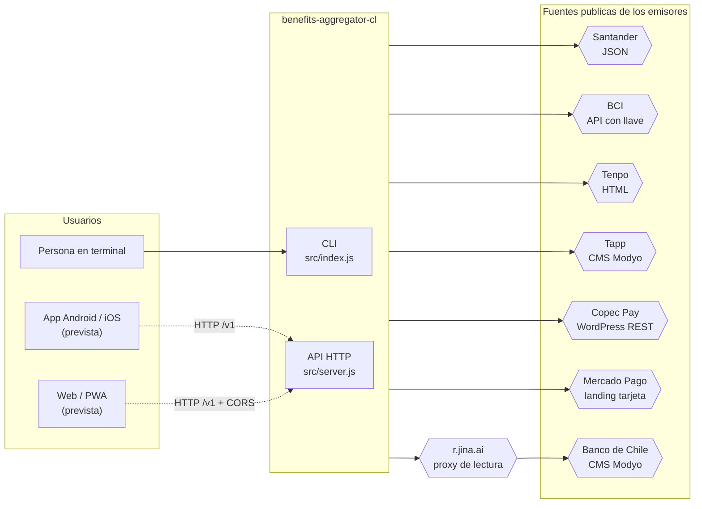

# 1. Contexto del sistema

Quién usa el sistema y de qué fuentes externas depende. No hay base de datos: cada fuente se consulta en vivo y en el servidor queda en caché en memoria.

**Leyenda**
- **Línea continua:** existe hoy.
- **Línea punteada:** cliente previsto, que todavía no existe en el repositorio.
- **Hexágono:** sistema externo.

**Notas**
- **Banco de Chile** está detrás de Incapsula (responde 302/403 a clientes automatizados), por eso se lee a través de `r.jina.ai`. Ver [ADR 0012](../adr/0012-banco-de-chile-via-api-modyo-y-jina.md).
- **Mercado Pago** se lee desde la landing de beneficios de la tarjeta, su landing por beneficio y los términos de cada campaña. No tiene API JSON: se usa el estado que la página trae incrustado. Ver [ADR 0018](../adr/0018-futuro-de-mercado-pago.md).
- **Las URLs exactas** de cada fuente están en la constante `URL`, `BASE_URL` o `API_URL` de cada `src/providers/*.provider.js`.
