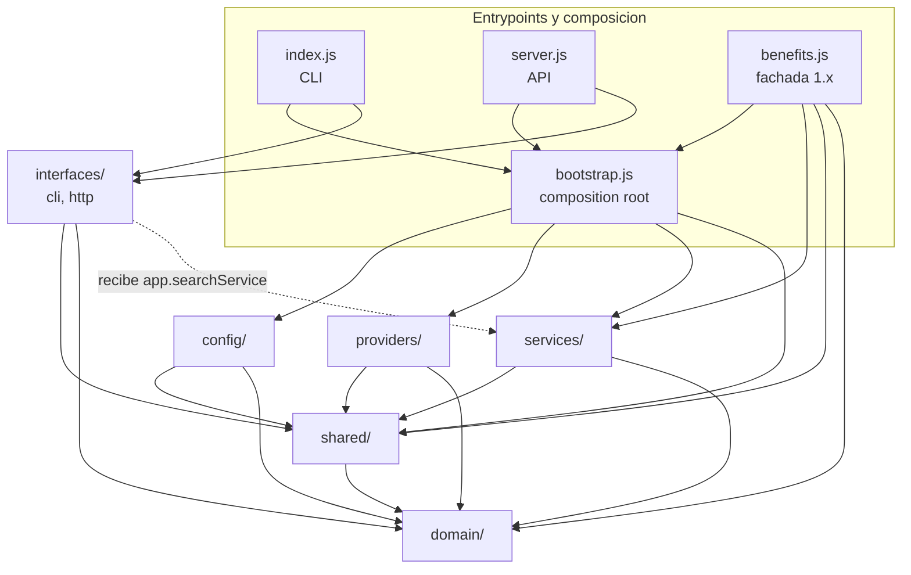

# 2. Capas y dependencias

Qué carpeta de `src/` importa a cuál, según los `require` reales del código. Las dependencias apuntan hacia `domain`.

**Leyenda**
- **Línea continua:** `require` real entre carpetas, obtenido recorriendo los imports de `src/`.
- **Línea punteada:** uso inyectado en tiempo de ejecución, sin import. `interfaces/` recibe el `searchService` ya armado a través del objeto `app` que entrega `bootstrap.js`.

## Dependencias prohibidas

`npm run lint` (`scripts/lint.js`, regla "dependencias entre capas") falla si aparece alguno de estos imports:

| Capa | No puede importar |
|---|---|
| `domain` | `config`, `shared`, `providers`, `services`, `interfaces` |
| `shared` | `providers`, `services`, `interfaces` |
| `config` | `providers`, `services`, `interfaces` |
| `providers` | `services`, `interfaces`, `config` (la configuración llega en `ctx.config`) |
| `services` | `providers` (los recibe por el registro), `interfaces`, `config` |

Estos casos **no tienen restricción** en el lint:
- `interfaces/` y los archivos de la raíz de `src/` (`bootstrap.js`, `index.js`, `server.js`, `benefits.js`). Que `interfaces/` hoy solo importe `shared` y `domain` es una convención, no una regla verificada (ver la duda abierta en [ADR 0013](../adr/0013-reglas-de-arquitectura-con-lint-propio.md)).

El mismo lint verifica además:
- `process.env` solo en `src/config/`;
- `fetch` global solo en `src/shared/http-client.js`;
- ninguna llave de 32 caracteres hexadecimales en `src/` ni en `docs/`;
- máximo 200 líneas por módulo.

Decisiones relacionadas: [ADR 0001](../adr/0001-arquitectura-por-capas-con-composition-root.md) y [ADR 0013](../adr/0013-reglas-de-arquitectura-con-lint-propio.md).
