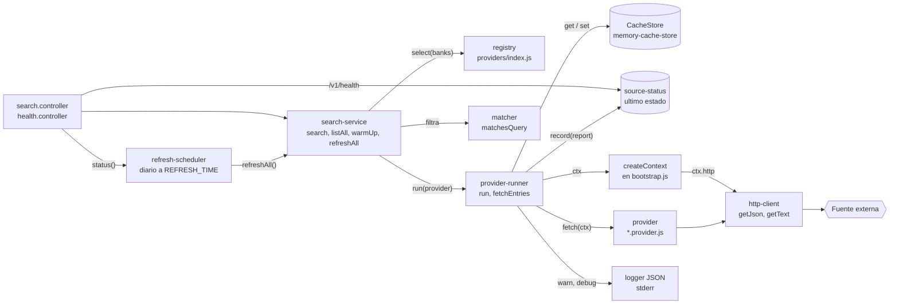

# 3. Componentes del backend

Cómo se conectan en tiempo de ejecución las piezas que arma `createApp()` en `src/bootstrap.js`.

**Leyenda**
- **Cilindro:** estado en memoria del proceso.
- **Hexágono:** sistema externo.
- **Texto en las flechas:** el método que se llama.

**Responsabilidades**

| Componente | Archivo | Hace | No hace |
|---|---|---|---|
| `search-service` | `src/services/search-service.js` | Elige emisores, los corre en paralelo (`Promise.all` sobre `runner.run`), filtra y arma `{ matches, errors, sources }` | Conocer emisores concretos |
| `refresh-scheduler` | `src/services/refresh-scheduler.js` | Timer nativo hasta la próxima `REFRESH_TIME` de Chile; llama a `refreshAll` (sin solapar), guarda `lastRun` y reprograma ([ADR 0024](../adr/0024-actualizacion-diaria-programada.md)). Solo lo arranca `src/server.js` | Decidir cuánto dura la caché (eso lo define `bootstrap.js`) |
| `provider-runner` | `src/services/provider-runner.js` | Caché, deduplicación de peticiones en curso, timeout por emisor, estados `ok`/`empty`/`error`, log | Parsear datos |
| `registry` | `src/providers/index.js` | Lista ordenada de providers, `get`, `find` y `select` por nombre o `key` | Ejecutar providers |
| `CacheStore` | `src/shared/cache/` | `get`, `set` (con TTL), `delete` y `clear`, asíncronos | Decidir qué se cachea |
| `http-client` | `src/shared/http-client.js` | Único uso de `fetch`: user-agent, timeout por petición, reintento en 429, error `"<Emisor> respondio <status>"` | Saber de emisores |
| `source-status` | `src/services/source-status.js` | Guarda el último `SourceReport` de cada emisor, para `/v1/health` | Consultar fuentes |
| `logger` | `src/shared/logger.js` | Una línea JSON por evento en stderr, con nivel `LOG_LEVEL` | — |

El detalle del runner está en el [diagrama 5](05-provider-runner.md).
