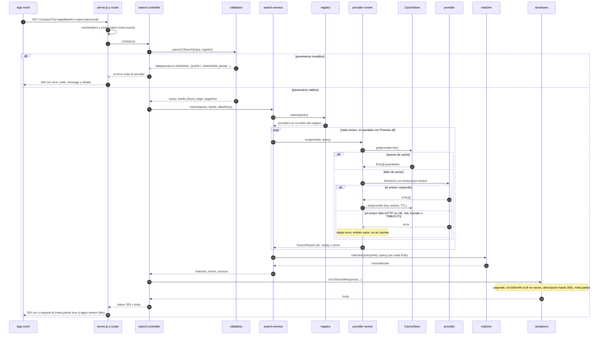

# 4. Secuencia de `GET /v1/search`

Qué ocurre desde que la app pide una búsqueda hasta que recibe la respuesta. Incluye el acierto y el fallo de caché y el caso en que un emisor falla.

**Leyenda**
- **`->>`:** llamada.
- **`-->>`:** respuesta.
- **`--x`:** error lanzado.
- **Números:** orden de los pasos.

**Qué tiene que saber la app**
- **Un emisor caído no convierte la respuesta en error.** La API responde 200 con los demás resultados, `meta.partial: true` y el detalle en `errors[]` y en `sources[]`. Solo los parámetros inválidos producen 4xx (ver el [diagrama 8](08-manejo-errores.md)).
- **La caché decide la latencia.** Un acierto responde en milisegundos (`sources[].cached: true`). Un fallo descarga la fuente: unos 16 s en Banco de Chile y unos 8 s en BCI.
- **Orden de los resultados:** primero por emisor (en el orden de `GET /v1/banks`) y, dentro de cada uno, en el orden de la fuente. No hay ranking.
- **La paginación** se aplica después de filtrar todas las coincidencias, así que `pagination.total` es el total real.
- **Cada petición se registra** en el log (`http_request`) con su `x-request-id`.

El código de este flujo está en `src/interfaces/http/controllers/search.controller.js` (`runV1`), `src/services/search-service.js` (`search`) y `src/interfaces/http/serializers.js` (`toV1SearchResponse`).
