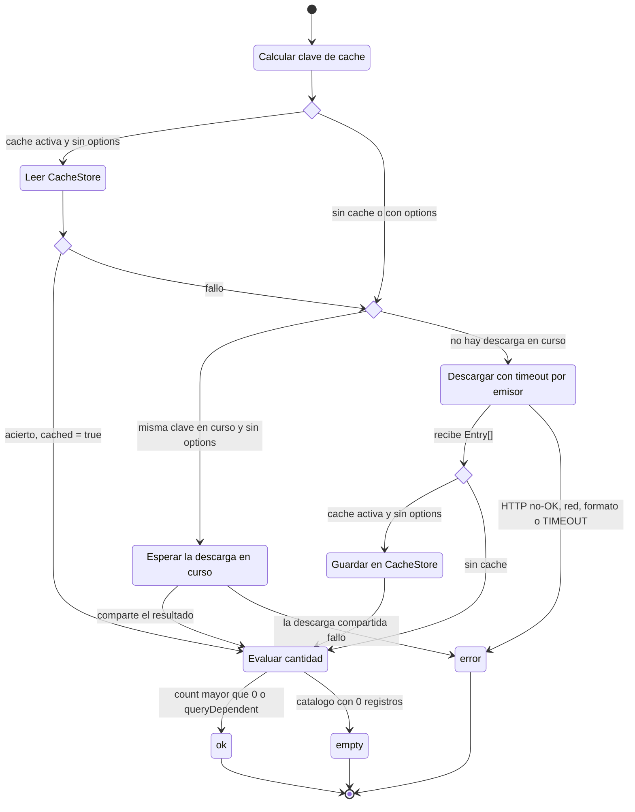

# 5. Ciclo del `provider-runner`

Estados por los que pasa un emisor dentro de `runner.run()` (`src/services/provider-runner.js`): caché, deduplicación de descargas en curso, timeout y resultado final.

**Leyenda**
- **Rombo:** decisión.
- **Estados finales:** son los valores de `SourceReport.status`.
- Al terminar, en los tres casos, el runner mide `durationMs` y llama a `statusTracker.record(report)`. Esa información alimenta `/v1/health`.

**Detalles verificables en el código**

| Tema | Comportamiento |
|---|---|
| **Clave de caché** | `provider:<key>`. Los providers con `queryDependent` (Mercado Pago) usan `provider:<key>:q:<consulta normalizada>`, así que "El Café" y "el cafe" comparten entrada. |
| **Caché activa** | Solo si se inyectó un `CacheStore` y `cacheTtlMs > 0`. El servidor usa caché en memoria; el CLI y la fachada pasan `cache: null` ([ADR 0008](../adr/0008-cli-y-fachada-sin-cache-ni-timeouts.md)). |
| **`options`** | `fetchEntries(provider, { options })` (por ejemplo `fetchCopec({ includeInactive: true })` de la fachada) se salta la caché y la deduplicación, porque el resultado depende de las opciones. |
| **Deduplicación** | Un `Map` de promesas en curso por clave: si llegan N peticiones simultáneas al mismo emisor, se hace una sola descarga. |
| **Timeout** | `AbortSignal.timeout(PROVIDER_TIMEOUT_MS)` se combina con el `signal` del contexto. Al vencer, se rechaza con `TimeoutError` ("`<Emisor>` excedio el tiempo limite (N ms)") y la señal aborta las peticiones HTTP y las pausas en curso. Cada petición tiene además su propio `HTTP_TIMEOUT_MS`, en el `http-client`. |
| **Errores** | Nunca se cachean. Se normalizan con `errorCode(err)` (ver el [diagrama 8](08-manejo-errores.md)) y se registran como `provider_error` en el log. |
| **`empty`** | Un catálogo que llega vacío suele significar que la fuente cambió y el parser ya no encuentra datos (por ejemplo, la regex de Tenpo). Se marca `empty`, se registra `provider_empty` en el log y `/v1/health` pasa a `degraded`. Se guarda en caché solo 1 minuto, no el TTL completo, para que el emisor vuelva a aparecer apenas se recupere la fuente. En los providers por consulta (Mercado Pago), 0 resultados es normal y se guarda el TTL completo. |
