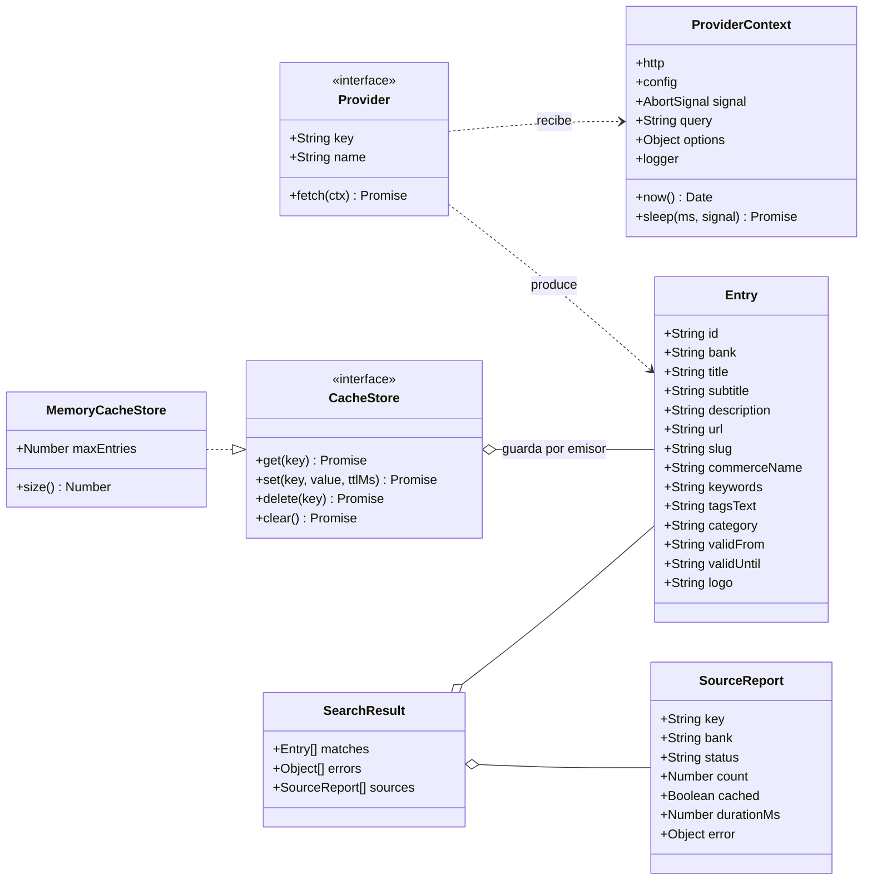
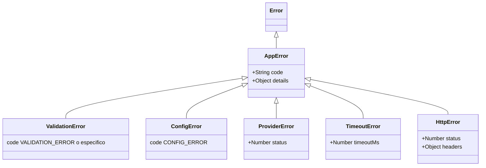

# 6. Modelo de dominio

Los tipos que comparten todas las capas. No hay clases de dominio en el código, salvo los errores: son objetos planos creados por factories y contratos verificados en tiempo de ejecución (`createEntry`, `defineProvider`, `assertCacheStore`). Por eso se dividen en dos diagramas.

## 6a. Beneficio, provider, caché y resultados

**Leyenda**
- **`..>`:** usa o produce.
- **`..|>`:** implementa el contrato.
- **`o--`:** contiene.

| Tipo | Dónde | Reglas |
|---|---|---|
| `Entry` | `src/domain/entry.js` | `createEntry(fields, { sourceId, logo })` exige `bank` y valida que los campos de texto sean `string`. Además: • conserva el orden de claves recibido; • agrega `id` y `logo` al final; • congela el objeto (`Object.freeze`), porque la caché comparte objetos entre peticiones. `id` = `<slug del emisor>-<12 hex de sha1(bank\|sourceId)>`; sin `sourceId`, usa `url\|slug\|title`. `toLegacyEntry` quita `id` y `logo` (forma 1.x). |
| `Provider` | `src/providers/provider.interface.js` | `defineProvider` valida `key` en kebab-case, `name` y `fetch`, y congela el objeto. |
| `ProviderContext` | lo arma `createContext` en `src/bootstrap.js` | Es la única vía de un provider a la red (`http`), el reloj (`now`), las pausas (`sleep`) y la configuración (`config`). |
| `CacheStore` | `src/shared/cache/cache-store.js` | Contrato asíncrono a propósito, para poder implementarlo sobre Redis ([ADR 0007](../adr/0007-cache-en-memoria-detras-de-cachestore.md)). |
| `SourceReport` | `src/services/provider-runner.js` | `status` puede ser `ok`, `empty` o `error`. Internamente lleva también `entries`, que se quitan antes de exponerlo. `source-status` le agrega `checkedAt`. |
| `SearchResult` | `src/services/search-service.js` | Cada elemento de `errors` tiene `{ bank, key, code, message }`. |

El campo `Entry` que llega a la app no es exactamente este: `serializers.toV1Benefit` lo transforma (agrega `bankKey`, convierte los vacíos en `null`, recorta la descripción y quita `slug`, `keywords` y `tagsText`). El contrato público es `Benefit`, en [`openapi.yaml`](../openapi.yaml).

## 6b. Jerarquía de errores

**Leyenda:** `<|--` es herencia (`extends`).

- **`ValidationError`, `ConfigError`, `ProviderError` y `TimeoutError`** están en `src/domain/errors.js`. `HttpError` vive en `src/interfaces/http/http-error.js`, porque solo existe en el transporte (404, 405, 413).
- **`errorCode(err)`** también da un código estable a errores nativos: `SyntaxError` → `INVALID_RESPONSE`, `AbortError` → `ABORTED`, `TypeError` "fetch failed" → `NETWORK_ERROR`; el resto → `PROVIDER_ERROR`.
- **Códigos que usan los providers** con `ProviderError`: `HTTP_ERROR`, `INVALID_RESPONSE` y `MISSING_CREDENTIALS`.
