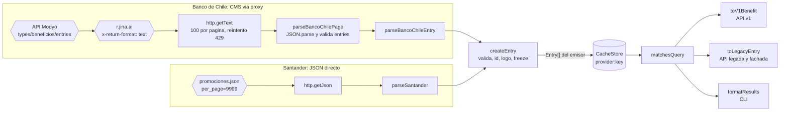

# 7. Flujo de datos de un emisor

Cómo viaja un beneficio desde la fuente hasta la respuesta, con dos casos reales de distinto tipo: Banco de Chile (CMS paginado leído a través de un proxy) y Santander (JSON directo en una sola llamada).

**Leyenda**
- **Hexágono:** fuente o servicio externo.
- **Cilindro:** caché, que solo existe en el servidor. En el CLI y la fachada, los `Entry` pasan directo al matcher.

**Qué hace cada paso**

| Paso | Banco de Chile (`bancochile.provider.js` + `bancochile.parser.js`) | Santander (`santander.provider.js`) |
|---|---|---|
| Petición | `https://r.jina.ai/http://sitiospublicos.bancochile.cl/api/content/...?per_page=100&page=N` con el header `x-return-format: text` (y `authorization` si hay `JINA_API_KEY`). Hoy son 10 páginas, con un tope de seguridad de 50 y 500 ms de pausa entre páginas | Una sola llamada a `promociones.json?per_page=9999&custom_fields=true` |
| Errores de la fuente | Un 429 se reintenta hasta 5 veces, respetando `retry-after` (8 s por defecto). Si la respuesta no es JSON, lanza `ProviderError INVALID_RESPONSE` | Un no-OK lanza `ProviderError HTTP_ERROR` ("Santander respondio N: ...") |
| Mapeo al `Entry` | `title` ← `fields.Titulo` `subtitle` ← `Tipo Beneficio` + `Extracto` `description` ← `Descripcion` sin HTML `category` ← `meta.category_name` `validUntil` ← `meta.unpublish_at` (fecha de Chile) `logo` ← `fields.Logo.url` `url` ← `/personas/beneficios/detalle/<slug>` `sourceId` ← `meta.uuid` | `subtitle` ← `custom_fields['Bajada externa']` (o `'Bajada interna'`) `commerceName` ← `title` `tagsText` ← `tags` `logo` ← `covers[0]` `sourceId` ← `item.id` |
| Registros (fixtures) | 919 | 315 |

**Partes comunes a todos los emisores**
1. **Validación:** `createEntry` exige que los campos de texto sean `string`. Si no lo son, el emisor entero falla con un error visible en vez de entregar datos corruptos ([ADR 0004](../adr/0004-entry-inmutable-con-id-estable.md)).
2. **Caché:** el runner guarda el **catálogo completo** del emisor, no las coincidencias. Así, una búsqueda distinta reutiliza la misma entrada de caché.
3. **Búsqueda:** el matcher normaliza (minúsculas, sin tildes ni puntuación) los campos `title`, `subtitle`, `description`, `slug`, `keywords`, `commerceName` y `tagsText`, y compara.
4. **Salida:** cada interfaz usa su propio serializer. La v1 entrega `Benefit` (campos `null`, `bankKey`, descripción de hasta 300 caracteres); la legada y la fachada entregan la forma 1.x (sin `id` ni `logo`); el CLI, texto.

Los demás emisores siguen uno de estos dos patrones:
- **Tapp** es CMS Modyo paginado, igual que Banco de Chile, pero sin proxy.
- **BCI** es una API paginada con llave.
- **Copec Pay** es JSON en una sola llamada, como Santander, y además filtra por vigencia.
- **Tenpo** es HTML con regex.
- **Mercado Pago** lee 3 niveles: la lista, una landing por beneficio y los términos de cada campaña (estos dos, en paralelo). Es el único que entrega `cardType`, `discountCap` y `termsUrl`.
