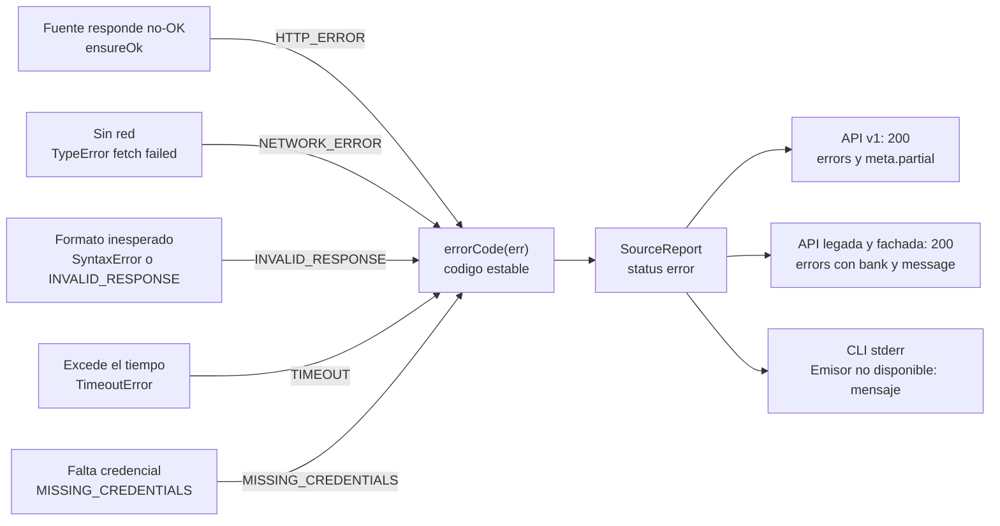
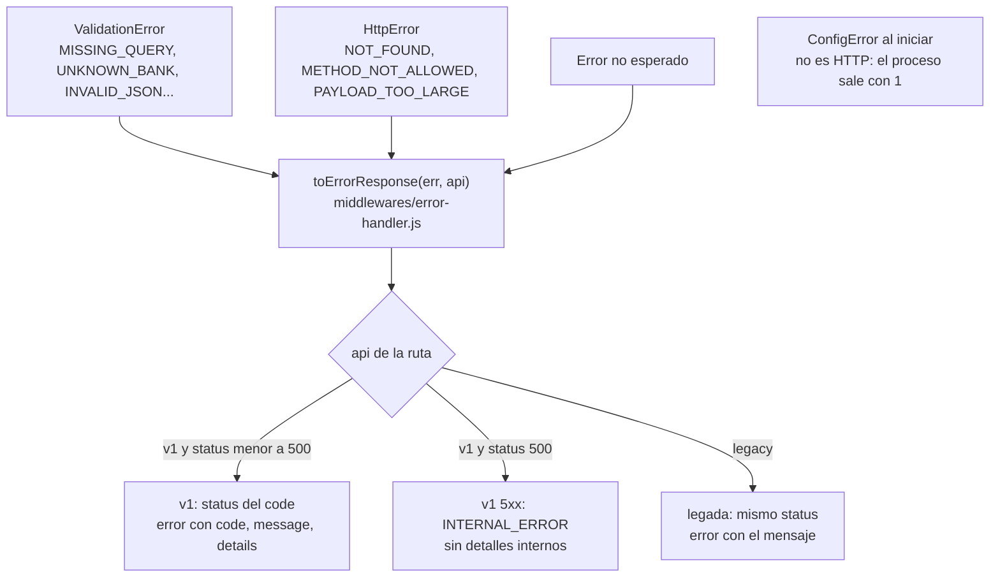

# 8. Manejo de errores

Hay dos familias de errores con caminos distintos:
- **Errores de un emisor:** la búsqueda continúa y la respuesta queda parcial.
- **Errores de la petición:** el servidor responde 4xx o 5xx.

## 8a. Error de un emisor: respuesta parcial (siempre 200)

**Leyenda:** el texto de las flechas es el `code` que recibe el cliente.

- El mensaje conserva el formato histórico, por ejemplo `"Mercado Pago respondio 403: {...}"`. Está pensado para diagnóstico: la app debe decidir por `code`.
- La fachada `benefits.js` es la excepción: `fetchSantander()`, `fetchBci()` y las demás rechazan la promesa con el error, igual que en la versión 1.x. Solo `searchBenefits` lo convierte en `errors`.

## 8b. Error de la petición: de excepción a respuesta HTTP

**Leyenda**
- **Rombo:** decisión según el campo `api` de la ruta (`legacy` o `v1`, definido en `routes.js`). Si la ruta no existe, el router decide por el prefijo `/v1`.
- **Nodo `ConfigError`:** está aislado a propósito, porque no pasa por el handler: lo atrapan `src/server.js` y `runCli`, que imprimen `Error: <mensaje>` y terminan con código 1.

## Códigos y status

Tomados de `STATUS_BY_CODE` en `src/interfaces/http/middlewares/error-handler.js`:

| `code` | HTTP | Cuándo |
|---|---|---|
| `MISSING_QUERY` | 400 | Falta `q`/`query` o está vacía |
| `QUERY_TOO_LONG` | 400 | Más de 100 caracteres |
| `UNKNOWN_BANK` | 400 | `banks` con un emisor desconocido o más de 20; `details.allowed` lista las keys válidas |
| `INVALID_PAGINATION` | 400 | `page` < 1, o `pageSize` fuera de 1 a 100 |
| `INVALID_JSON` | 400 | Body que no se puede parsear |
| `INVALID_BODY` | 400 | Body JSON que no es un objeto (solo v1) |
| `NOT_FOUND` | 404 | Ruta inexistente (ruteo exacto) |
| `METHOD_NOT_ALLOWED` | 405 | Método no soportado en una ruta `/v1`, con el header `Allow` |
| `PAYLOAD_TOO_LARGE` | 413 | Body mayor que `BODY_LIMIT_BYTES` |
| `INTERNAL_ERROR` | 500 | Cualquier otro error. En v1, el mensaje es genérico |

**Diferencias deliberadas de la API legada**, para mantener la compatibilidad 1.x ([ADR 0006](../adr/0006-api-versionada-v1-con-rutas-legadas.md)):
- El body es `{ "error": "<mensaje>" }` y en un 500 expone el mensaje.
- Un método no soportado responde 404, no 405.
- Un JSON que no es objeto se trata como `{}`, así que responde 400 con "Falta el campo query".
