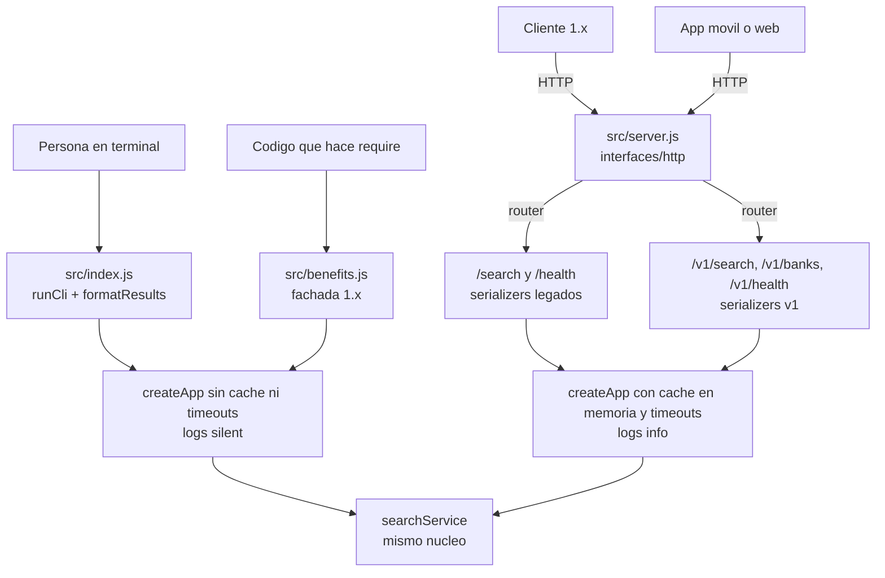

# 9. Interfaces y compatibilidad

Cuatro puertas de entrada usan el mismo núcleo (`searchService`). Cambian en cómo arman la app (`createApp`) y en cómo serializan la salida.

**Leyenda:** las flechas siguen el camino de una petición, de arriba hacia abajo.

| Interfaz | Cliente | Formato de salida | Caché | Timeouts | Logs por defecto | Estabilidad |
|---|---|---|---|---|---|---|
| CLI `node src/index.js "<texto>"` | Persona | Texto, el mismo formato de 1.x | No | No | `silent` | Estable |
| Fachada `require('./src/benefits')` | Código Node | `searchBenefits` → `{ matches, errors: [{ bank, message }] }`, con el `Entry` 1.x | No | No | `silent` | Estable (compatibilidad 1.x) |
| API legada `/search`, `/health` | Clientes 1.x | `{ matches, errors }` y `{ status: "ok" }` | Sí | Sí | `info` | **Deprecada**, se mantiene |
| API v1 `/v1/*` | App móvil y web | `SearchResponse` de [`openapi.yaml`](../openapi.yaml) | Sí | Sí | `info` | Contrato actual |

**Por qué el CLI y la fachada no usan caché ni timeouts:** conservan exactamente la semántica 1.x. Cada ejecución es un proceso nuevo, así que la caché no aportaría nada, y en una prueba en vivo Banco de Chile superó los 60 s de timeout por lentitud de `r.jina.ai`. Ver [ADR 0008](../adr/0008-cli-y-fachada-sin-cache-ni-timeouts.md).

**Para una app nueva:** usa siempre `/v1`. Las rutas sin versión no reciben campos nuevos (`id`, `logo`, paginación) ni el formato de errores uniforme.
