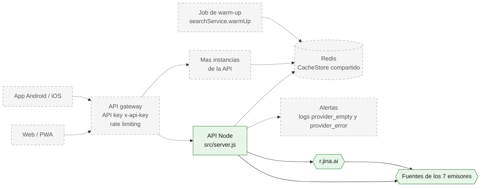

# 10. Arquitectura objetivo (futuro)

> **Esto todavía no existe.** Muestra hacia dónde se propone llevar el sistema para publicarlo a clientes móviles y web. Las piezas futuras corresponden a ADR en estado **propuesto**: no están aprobadas ni implementadas.

**Leyenda**
- **Verde, borde continuo:** existe hoy.
- **Gris, borde punteado:** **futuro**, propuesto.
- **Flecha continua:** conexión que existe hoy.
- **Flecha punteada:** conexión futura.

| Pieza futura | Por qué | Qué ya existe para habilitarla | ADR |
|---|---|---|---|
| App móvil y web/PWA | Son los clientes objetivo | `/v1` con contrato OpenAPI, CORS configurable (`CORS_ORIGINS`) | — |
| API gateway | Rotar llaves sin reiniciar, con cuotas y métricas por cliente | La API key ya está en el código (`API_KEYS`, `Authorization: Bearer`, nombre del cliente en el log) | [0014](../adr/0014-autenticacion-con-api-key.md) |
| Rate limiting | Cada fallo de caché dispara unas 25 peticiones a fuentes externas | — | [0015](../adr/0015-rate-limiting.md) |
| Varias instancias + Redis | Con caché solo en memoria, cada instancia descarga todo por su cuenta | El contrato `CacheStore` asíncrono e inyectable en `createApp({ cache })` | [0016](../adr/0016-cachestore-compartido-en-redis.md) |
| Job de warm-up y stale-while-revalidate | Que ningún usuario espere 10-20 s con la caché fría | `searchService.warmUp()`, `CACHE_WARMUP` y `/v1/health?probe=true` | [0017](../adr/0017-warm-up-programado-y-stale-while-revalidate.md) |
| Alertas sobre los logs | Detectar a tiempo un parser roto o una llave vencida | Logs JSON con `provider_empty` y `provider_error` | — |

La dependencia de `r.jina.ai` también tiene una decisión abierta: [ADR 0021](../adr/0021-acceso-a-banco-de-chile-sin-proxy-gratuito.md). La fuente de Mercado Pago ya se resolvió ([ADR 0018](../adr/0018-futuro-de-mercado-pago.md)).
