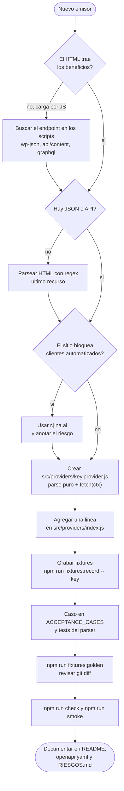

# 11. Cómo agregar un emisor

Los pasos de [`docs/AGREGAR_EMISOR.md`](../AGREGAR_EMISOR.md) en forma visual. La guía tiene el detalle, incluida la plantilla de código.

**Leyenda**
- **Rombo:** decisión.
- **Óvalo:** inicio o fin.

**Lo que no hace falta tocar:** `services/`, `interfaces/` ni `bootstrap.js`. El emisor aparece solo en `/v1/banks`, en las búsquedas y en `/v1/health`, porque todos leen el registro ([ADR 0003](../adr/0003-contrato-de-provider-y-registro.md)).

**Checklist del provider** (`npm run lint` verifica los puntos marcados con ✓)
- No usar `fetch` ni `process.env` directamente: usar `ctx.http` y `ctx.config`. ✓
- Usar `ctx.now()` en lugar de `new Date()`, y pasar `ctx.signal` a cada `http.*` y `sleep`.
- Pasar `label: NAME` en las peticiones, para que los errores salgan como "`<Emisor>` respondio N: ...".
- Asignar `sourceId` estable y `logo` en `createEntry`.
- Mantener el archivo bajo 200 líneas; si el parser crece, sepáralo en `<key>.parser.js`, como Banco de Chile. ✓
