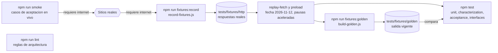

# 12. Estrategia de pruebas

Cómo se prueba un sistema que depende de 7 sitios externos sin acceder a internet, y dónde entran los golden y el smoke test en vivo.

> Diagrama adicional, no pedido en el brief: los fixtures, los golden y el preload son lo menos obvio del repositorio y lo primero que rompe quien llega nuevo.

**Leyenda**
- **Cilindro:** archivos versionados en el repositorio.
- **Hexágono:** sistema externo.
- `npm run check` corre `lint` y `test`; ninguno de los dos necesita internet.

| Tipo de prueba | Carpeta | Qué asegura |
|---|---|---|
| Unitarias | `tests/unit/` | Parsers, `http-client`, `config`, caché, runner, router, validación y serializers, con dobles inyectados por `ctx` |
| Caracterización | `tests/characterization/` | El CLI, la API legada y la fachada producen **byte a byte** lo mismo que el golden |
| Aceptación | `tests/acceptance/` | PROWASHGO, temu, pedidos ya, burger king, Rappi y El Café Rosa funcionan por servicio, CLI y API |
| Contrato | `tests/interfaces/` | La API v1 completa y su sincronía con `openapi.yaml` |
| En vivo | `npm run smoke` | Los casos de aceptación contra las fuentes reales |

**Procesos hijo.** El CLI y el servidor se prueban como procesos separados, cargando `tests/helpers/preload.js` con `-r`. Ese archivo reemplaza `fetch` global, congela `Date` y acelera las pausas de 100 ms o más. Los timeouts usan `AbortSignal.timeout`, que el preload no toca, así que la aceleración no los dispara antes de tiempo.

**Si un golden falla:**
- **Sin un cambio intencional:** es una regresión. Hay que arreglar el código.
- **Con un cambio intencional:** regenerar con `npm run fixtures:golden` y revisar `git diff tests/fixtures/golden`. Ver [ADR 0009](../adr/0009-tests-de-caracterizacion-con-fixtures-y-golden.md).
